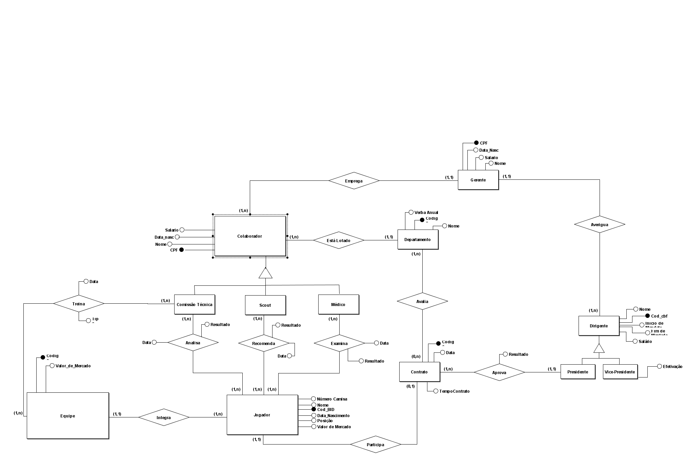

# Sistema de Gerenciamento de Clube de Futebol

Projeto de banco de dados relacional desenvolvido para a disciplina de Banco de Dados, com foco na modelagem e implementação de informações relacionadas à gestão de um clube de futebol. O projeto reúne um modelo entidade-relacionamento e um script SQL com a estrutura das tabelas e dados de exemplo.

O escopo é o banco de dados: o repositório não inclui uma aplicação com interface gráfica ou uma API.

## Tecnologias
- SQL
- MariaDB (o dump foi gerado na versão 10.4.32; pode ser importado em ambientes compatíveis com MySQL)
- phpMyAdmin 5.2.1, utilizado para gerar o dump

## Funcionalidades modeladas
- Cadastro de jogadores e posições
- Controle de contratos
- Gerenciamento de departamentos
- Comissão técnica, médicos e scouts
- Processos de recomendação, análise e exame de jogadores

## Conteúdos abordados
- Modelagem Entidade-Relacionamento
- Chaves primárias e estrangeiras
- Relacionamentos 1:N e N:N
- Normalização

## Estrutura do projeto

```text
├── Clube_de_Futebol.sql              # Estrutura, dados e restrições do banco
├── ModeloEntidadeRelacionamento.png  # Diagrama entidade-relacionamento
└── README.md                         # Documentação do projeto
```

## Modelo de dados



O modelo representa jogadores e equipes, além das pessoas e departamentos envolvidos na gestão e na avaliação de atletas e contratos. No script SQL, as tabelas estão organizadas em torno dos seguintes conceitos:

| Tabelas | Descrição |
| --- | --- |
| `equipe`, `jogador` e `posicao` | Equipes, seus jogadores e as posições associadas a cada jogador. |
| `gerente`, `colaborador` e `departamento` | Gerentes, colaboradores e departamentos, incluindo vínculos entre eles. |
| `scout`, `medico` e `membcomissaotec` | Funções especializadas associadas a colaboradores. |
| `recomenda`, `examina` e `analisa` | Registros de recomendações, exames e análises de jogadores, com data e resultado. |
| `presidente`, `dirigente` e `contrato` | Dados de dirigentes e presidentes e contratos associados a jogadores e presidentes. |
| `departamento_avalia_contrato` | Associação entre departamentos e contratos avaliados. |

Por exemplo, uma equipe pode ter vários jogadores, enquanto um departamento pode estar associado a vários contratos e um contrato pode ser avaliado por vários departamentos. As tabelas de recomendação, exame e análise relacionam profissionais aos jogadores avaliados.

**Observação:** o diagrama representa o modelo conceptual e não corresponde integralmente ao script. Por exemplo, vice-presidente e o relacionamento de treino aparecem no diagrama, mas não possuem tabelas próprias no SQL. Além disso, a chave estrangeira entre `dirigente` e `presidente` está implementada no sentido de `dirigente` para `presidente`. Para verificar as restrições efetivamente aplicadas, consulte o arquivo SQL.

## Como executar

### Pré-requisitos

- Um servidor MariaDB e um cliente SQL, como o cliente de linha de comando ou o phpMyAdmin.
- Permissão para criar um banco de dados e importar tabelas.

### Importação pela linha de comando

Na pasta do projeto, crie o banco de dados e importe o arquivo:

```bash
mysql -u SEU_USUARIO -p -e "CREATE DATABASE santosfc CHARACTER SET utf8mb4 COLLATE utf8mb4_general_ci;"
mysql -u SEU_USUARIO -p santosfc < Clube_de_Futebol.sql
```

Substitua `SEU_USUARIO` pelo seu usuário do banco. O script não cria nem seleciona o banco de dados, por isso essas etapas são necessárias. Importe-o em um banco vazio: ele cria tabelas e insere dados de exemplo, e não foi preparado para ser executado repetidamente sobre as mesmas tabelas.

### Importação pelo phpMyAdmin

1. Crie um banco chamado `santosfc` com codificação `utf8mb4`.
2. Selecione o banco criado e abra a aba **Importar**.
3. Selecione `Clube_de_Futebol.sql` e execute a importação.

## Exemplos de consultas

Listar jogadores e suas posições:

```sql
SELECT j.Nome, j.Numero, p.NomePosicao
FROM jogador AS j
LEFT JOIN posicao AS p ON p.Cod_BID_FK = j.Cod_BID
ORDER BY j.Nome;
```

Consultar contratos e os jogadores associados:

```sql
SELECT c.Codigo, j.Nome, c.Data, c.TempoContrato, c.Resultado
FROM contrato AS c
JOIN jogador AS j ON j.Cod_BID = c.Cod_BID_FK
ORDER BY c.Codigo;
```

## Observações sobre os dados

O arquivo SQL já inclui registros de exemplo para facilitar o estudo e as consultas. Alguns nomes no próprio dump contêm caracteres substituídos por `?`; a importação não recupera automaticamente esses caracteres. O banco utiliza chaves estrangeiras, mas algumas tabelas de associação não possuem chave primária ou restrição de unicidade, permitindo registros duplicados.
